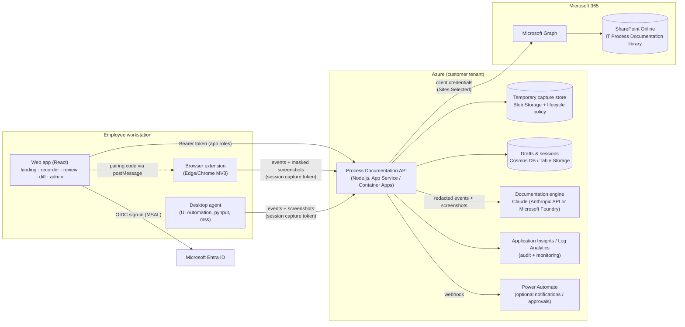

# Process Documentation Agent – Solution Architecture

## 1. Recommendation: hybrid solution

| Option | Can it see the real task? | Verdict |
|---|---|---|
| Web application only | No. A browser tab cannot observe other tabs, other applications, clicks or UI element names. Screen sharing (`getDisplayMedia`) gives pixels only. | Not sufficient on its own |
| Desktop application only | Yes, but the review/approval experience, RBAC and SharePoint publishing would be duplicated in a thick client and harder to roll out and update. | Heavy to operate |
| **Hybrid: web app + capture components** | Yes. Lightweight capture components observe the work; everything else (review, AI, approval, publishing) is a central web service. | **Recommended** |

An AI model cannot capture desktop activity by itself. Capture needs components that run where the work happens:

| Capture component | Where it runs | What it captures | Status in this prototype |
|---|---|---|---|
| **Browser extension** (Chrome/Edge, Manifest V3) | User's browser, deployed through Intune / Edge management policy | Navigation (incl. single-page apps), clicked element name/role, field labels, selected options, submitted forms, toasts/alerts/errors, privacy-masked screenshots with the clicked element highlighted | **Implemented and tested end to end** with real Chromium |
| **Desktop agent** (Python; packaged as a signed MSI for production) | Windows workstation / jump host | Foreground application and window, clicked element name/control type via **Microsoft UI Automation**, field entry (character count only, never the text), shortcuts, screenshot of the active monitor | **Implemented**; core logic unit-tested (7 tests). Not run against a real Windows desktop from this environment |
| **Screen sharing** (in the web app) | Any browser | Screenshots when the screen changes, for apps neither component can read | Implemented, needs manual testing (requires a user permission prompt) |

Both components speak the same event format to the same capture API, so the documentation engine does not care where an event came from.

For a pure Microsoft-ecosystem alternative to the Python desktop agent, the same `core.py` logic can be ported to a .NET 8 tray application using `System.Windows.Automation`, signed and deployed with Intune. The event contract stays identical.

## 2. Architecture diagram

## 3. Components (as built)

| Path | Responsibility |
|---|---|
| `web/` | React SPA (Vite). Landing/dashboard, new and update workflows, recording interface, review and editing, comparison view, administration. |
| `extension/` | Browser capture extension. `content.js` observes the page; `background.js` pairs, queues durably, masks and captures screenshots, mirrors status in the toolbar badge (`REC` / `II`). |
| `desktop-agent/` | Desktop capture agent. `core.py` (platform independent, tested), `platforms.py` (Windows UIA / macOS / X11), `__main__.py` (listeners, indicator, uploader). |
| `server/app.js` | REST API: capture ingestion, sessions, drafts, approval, publishing, dashboard, admin. |
| `server/engine/redact.js` | Redaction and capture policy (secrets, tokens, card numbers, IBANs, e-mail masking, sensitive fields, excluded apps/URLs). Applied again on the server. |
| `server/engine/segment.js` | Deterministic step reconstruction from events (noise removal, ordering, step boundaries). |
| `server/engine/generate-rules.js` | Rule-based documentation engine (fallback, and the evidence skeleton for the AI engine). |
| `server/engine/generate-llm.js`, `prompts.js` | Claude documentation engine with structured output and server-side guardrails. |
| `server/engine/compare.js` | Comparison engine (alignment, change classification, per-change merge). |
| `server/engine/render.js` | Word (.docx) and Markdown rendering of the standard template. |
| `server/repo/sharepoint.js`, `graph.js` | SharePoint repository via Microsoft Graph. |
| `server/repo/local.js` | Local-folder repository with identical semantics, for running without a tenant. Clearly labelled “not SharePoint” in the UI. |
| `server/auth.js` | Entra ID token validation + app roles; prototype “dev” mode with test users. |
| `server/retention.js`, `audit.js` | Retention of raw capture data; append-only audit log. |

## 4. Data flow

1. **Start.** The user enters the title (or picks an existing process), gives explicit consent and starts recording. The API creates a session with a 6-digit pairing code.
2. **Pair.** The web app hands the code to the extension (`window.postMessage`), or the user starts the desktop agent with the code. The API issues a per-session **capture token** (stored only as a SHA-256 hash). Capture clients never hold a user token.
3. **Capture.** Clients send semantic events and screenshots. Events are redacted on the client and again on the server, dropped while paused, de-duplicated by client id, and appended to an append-only log so a crash or network outage does not lose data (clients queue and retry).
4. **Stop and generate.** The segmenter turns events into candidate steps with evidence. The Claude engine (if configured) writes the document; otherwise the rule engine does. Server guardrails then flag every step without evidence and every empty mandatory section as a clarification.
5. **Update only:** the comparison engine aligns the new steps with the approved version and classifies each change.
6. **Review.** The user edits, answers clarifications and (for updates) accepts or rejects each change. Approval is blocked while anything is open.
7. **Approve and publish.** An Approver approves (version number and change history are assigned), then publishes. The repository rejects the publish if the document changed since the draft was based on it (ETag / `If-Match`). Raw capture data is purged.

## 5. Recommended technology stack

| Layer | Choice | Why |
|---|---|---|
| Identity | Microsoft Entra ID, app roles `ProcessDoc.Contributor/Approver/Admin` | Single sign-on, Conditional Access, role assignment through Entra groups |
| Repository | SharePoint Online via Microsoft Graph v1.0 | Source of truth, native version history, metadata columns, permissions, search |
| Graph permission | `Sites.Selected` (application) + site-level `write` grant | Least privilege: the app can only touch the documentation site |
| Backend | Node.js 20+ (Express) in Azure App Service or Container Apps | Long-running AI calls and file rendering fit better than consumption Functions; Functions remain an option for the retention job |
| Temporary storage | Azure Blob Storage with lifecycle management, private endpoint, CMK optional | Retention enforced by the platform, not only by code |
| AI | Claude (`claude-opus-5-5`) through the Anthropic API or Microsoft Foundry; structured outputs; vision for screenshots | Strong multimodal understanding of UI screenshots and long event logs; schema-constrained output |
| Frontend | React + Vite, MSAL.js | Familiar, lightweight, easy to host as static files |
| Capture | MV3 extension (Edge/Chrome), UI Automation desktop agent | The only reliable way to get element names and field labels rather than just pixels |
| Workflow | Power Automate via webhook (optional) | Teams notifications or a formal approval flow without changing the app |
| Monitoring | Application Insights + Log Analytics; audit forwarded to Sentinel if required | Standard Azure operations |

Power Automate was evaluated as the main orchestrator and not chosen: capture ingestion is high-frequency and the comparison/approval logic needs to be versioned and unit-tested as code. It is used at the edges (notifications, optional formal approvals).

## 6. Implementation phases – status

| Phase | Scope | Status |
|---|---|---|
| 1 Functional prototype | Landing, new and update workflows, recording interface, documentation generation, review and editing | **Done, end-to-end tested** |
| 2 Recording intelligence | Screen capture, screenshot association, application recognition, step identification, sequence reconstruction | **Browser extension done and tested; desktop agent implemented, unit-tested core, not yet run on a real Windows desktop** |
| 3 SharePoint integration | Auth, search, retrieval, creation, updates, versions, metadata, folders | **Implemented against Graph and tested with a mocked Graph; not yet run against a real tenant** |
| 4 Intelligent updates | Comparison engine, change detection, diff view, per-change approval | **Done, tested** |
| 5 Enterprise readiness | RBAC, audit log, retention, admin interface, monitoring | **RBAC, audit, retention, admin UI done; Azure storage adapters, App Insights and MSI packaging are next** |
